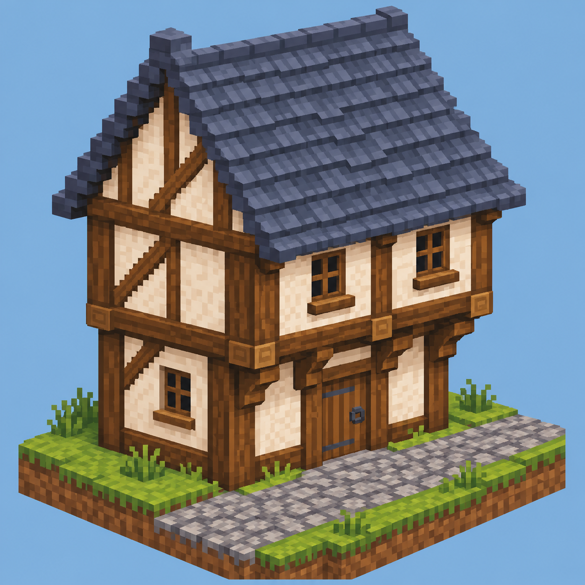

# Iron Age Architecture

Cob cottages, timber-framed houses and upper floors that reach out over narrow streets.

Iron Age Architecture adds building materials and structural details for medieval villages,
market towns and fantasy cities. Inspired by places such as Rye in East Sussex, it gives you
more control over the walls, framing and rooflines that give these buildings their character.

## Walls and roofs

Build with earthy cob or a pale limewashed finish, then choose how much timber you want to show.
The wattle-and-daub kit includes plain infill, substantial posts, horizontal rails, narrow studs,
close studding and diagonal braces. You choose the spacing and pattern, from a modest cottage
to a richly framed townhouse. Matching timbers join around corners and through intersections.

All six vanilla wood types are available. Cob comes in blocks, slabs and stairs, and smooth
thatch and slate roofs have automatic corners and separate ridge caps.

## Overhanging upper floors

Projecting upper storeys, known as jetties, are a central part of the kit. Half-depth walls,
short returns and matching corner posts let you move a facade out by half a block or a whole
block. Repeat the step on another storey to build the increasingly narrow streets of a fantasy city.

The extra space is usable inside. Timber floors finish the projection with floorboards,
exposed joists and continuous edge beams underneath. Optional brackets add detail below selected
floor edges, and matching corner pieces let the overhang continue around the side of a building.

## Getting started

The first alpha targets **Minecraft 1.10.2 with Forge**. Everything is crafted from vanilla
ingredients, and the main content families can be enabled or disabled in the configuration.

Iron Age Architecture works independently of Iron Age Furniture. You can use the two together
to build and furnish your village.

- [Building and crafting guide](docs/BUILDING-GUIDE.md)
- [Changelog](CHANGELOG.txt)
- [Report a problem](https://github.com/MinecraftModDevelopmentMods/IronAgeArchitecture/issues)
- [Development and local testing](docs/DEVELOPMENT.md)

This is an early alpha. Feedback on the appearance, crafting and placement of the pieces is
welcome, especially around corners and overhanging floors. Please include the mod version and
a screenshot when reporting a problem.
